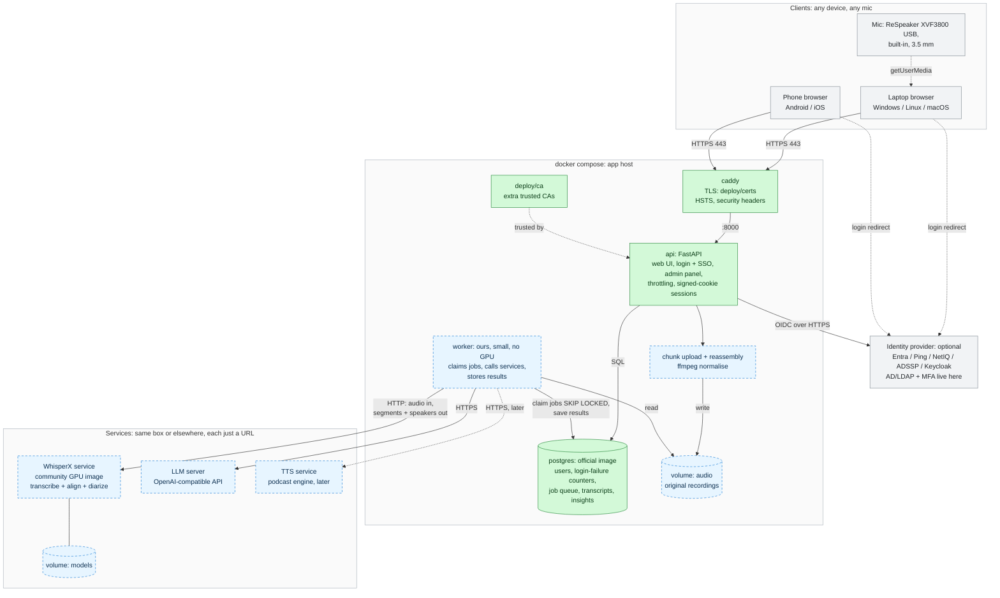
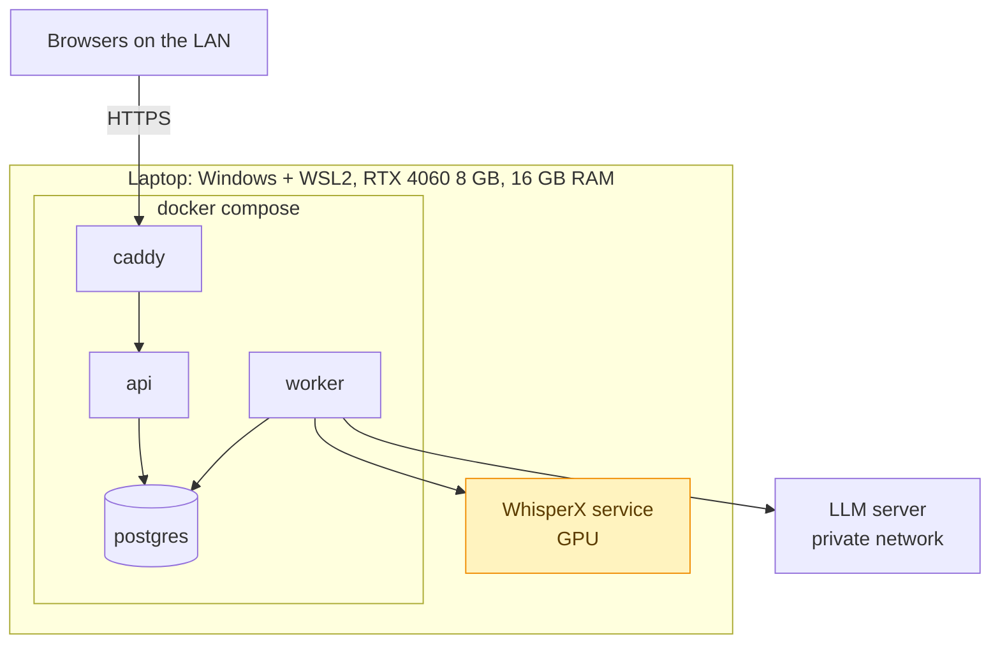
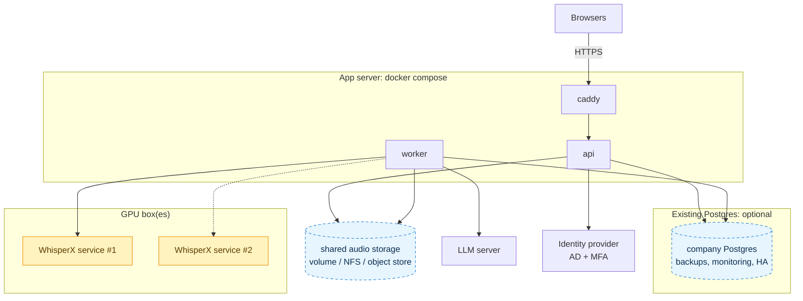
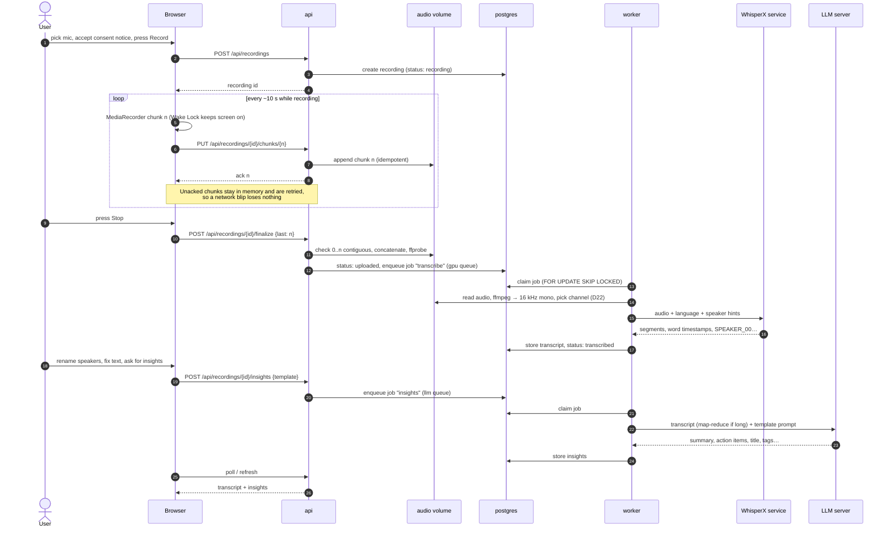
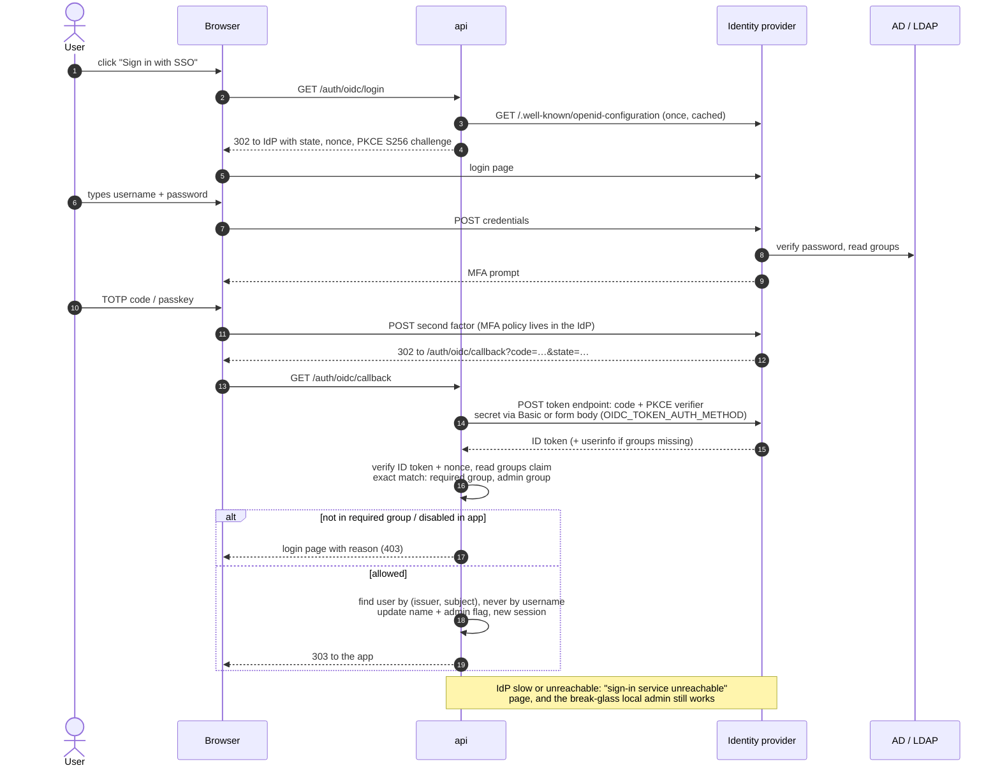
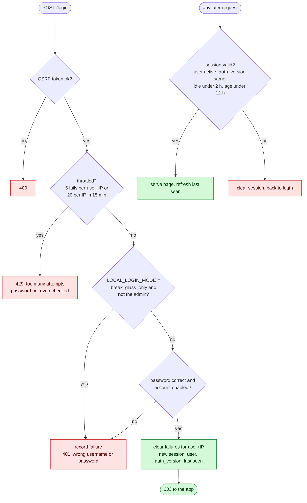
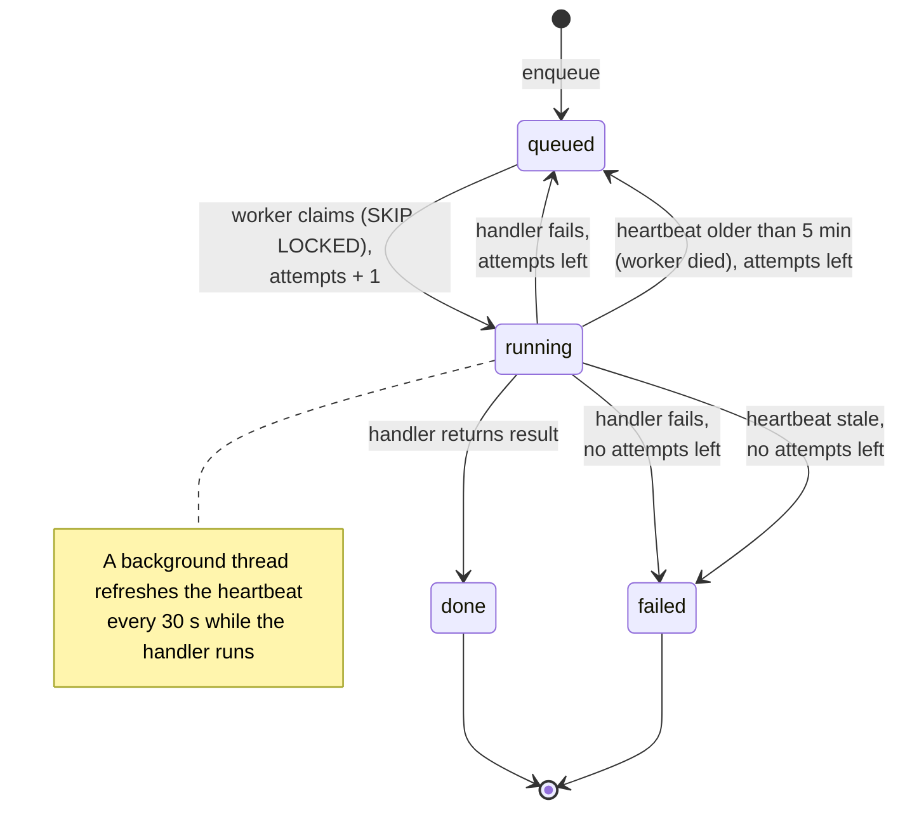

# Architecture diagrams

GitHub renders these Mermaid diagrams directly. Legend used throughout:

- **Solid green**: built and tested (M0, M1)
- **Dashed blue**: planned (M2+), shape agreed in [ARCHITECTURE.md](ARCHITECTURE.md)
- **Grey**: external, not part of this repo (you run or choose it)

## 1. System overview

Containers talk to each other over the network (decision D25). Only Caddy is
reachable from outside. Workers never talk to browsers: they claim jobs from
Postgres and write results back there.

The worker is partly built: the job queue, claiming, retries, heartbeats and
stale-job recovery exist and are tested. It's shown as planned because its
real work (calling the WhisperX and LLM services) arrives in M3/M4. Today it
only runs test jobs.

## 2. Deployment options

### POC: one laptop

### Production: split out as needed

Each arrow is just a URL in `.env` or the admin panel, so pieces move to other
machines without code changes.

Pointing `DATABASE_URL` at an external Postgres is planned but not yet wired
into `docker-compose.yml` (see D25). More GPUs = more WhisperX services and
workers; they all share the Postgres job queue.

## 3. Recording → transcript → insights

M2 covers the upload half and M3/M4 the processing half. Everything here is planned.

## 4. SSO login (OIDC)

Built and tested (M1) against Keycloak with LDAP and TOTP, over plain HTTP
and full HTTPS.

## 5. Local login safety

Disabling a user in the admin panel bumps their `auth_version`, which ends
every open session at the next request.

## 6. Job lifecycle

Built (M0) and used by every background task.

